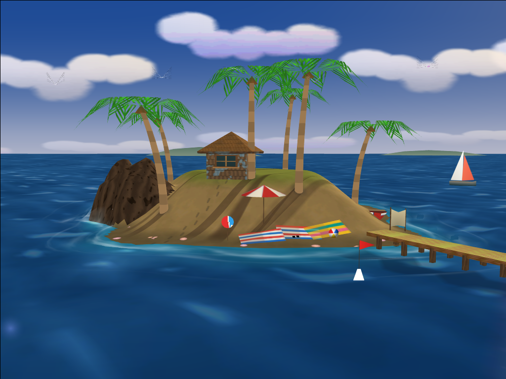

# Glide 3 Demos

## Island Scene

A procedural seaside tech demo for Glide 3. The scene generates its geometry and textures in C and uses Glide for rendering. It features animated waves and foam, sun-aligned terrain shadows, textured props, and optional T-Buffer depth of field.



*Captured on the Rougarou four-chip H5 RTL simulator at 1024×768 with 8× AA and an ARGB8888 framebuffer.*

### Build and run

Use a C compiler, a working Glide 3 installation, and a compatible board or runtime. Match the executable architecture to your Glide library. Glide 3 is the only external software dependency.

Set `GLIDE_INCLUDE` and `GLIDE_LIB` to your Glide 3 include and library directories. On a GNU-compatible Linux toolchain, build directly from the header.

```sh
cc -std=gnu17 -O2 -DGLIDE3 -DISLAND_SCENE_IMPLEMENTATION -DISLAND_SCENE_MAIN \
  -I"$GLIDE_INCLUDE" -x c island_scene.h -L"$GLIDE_LIB" -lglide3 -lm -o island
./island --help
./island -r 640x480 -n 300 --perf-hud
```

| Option | Effect |
| --- | --- |
| `-r 1024x768` | Requests 1024×768. The default is 640×480. |
| `-n 300` | Runs for 300 frames. |
| `-a 0\|2\|4\|8` | Requests the AA sample count. Supported modes depend on the Glide driver and board. |
| `-d` | Enables T-Buffer depth of field when the selected AA mode supports it. |
| `--perf-hud` | Displays wall-clock FPS and Glide framebuffer pixel rates. |

### Read the HUD

- **FPS** measures how quickly the demo runs on your current hardware or simulator. Simulator FPS includes the time spent simulating the board.
- **FBI pixels in / out** are the input and output rates from Glide's framebuffer-interface counters, in millions of pixels per second. Output depends on which fragments pass the pipeline tests. The values reflect the counters exposed by your Glide implementation.
- **Texels/s** is shown as unavailable. The demo has no TMU throughput counter.

Pass the options on the command line. The standalone demo uses Glide and the standard C runtime. Live keyboard controls and per-scanout capture are features of the separate Rougarou test runner.

### Embed the scene

Include `island_scene.h` from your C code and define `ISLAND_SCENE_IMPLEMENTATION` before including it in exactly one translation unit. Call `island_scene_run(argc, argv)` once per process. It owns the Glide context until it returns. Define `ISLAND_SCENE_MAIN` in the implementation file if you want the supplied CLI entry point.

### Redistribution

Glide headers, drivers, and binaries carry their own terms. This repository contains the demo source and its screenshot.
